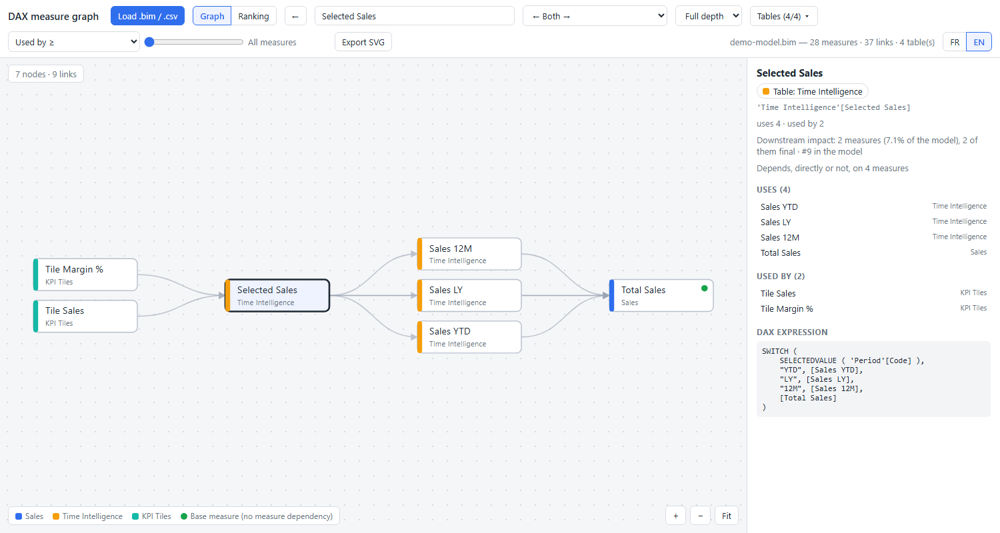
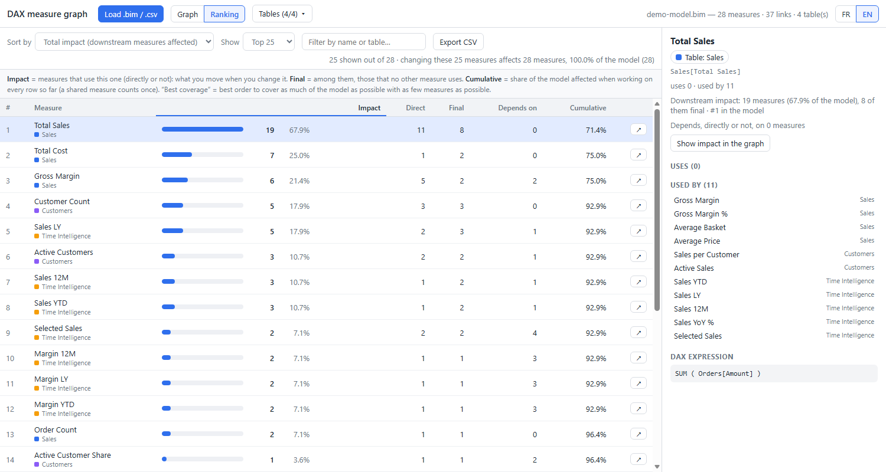

# DAX Measure Graph

A single-file HTML tool to **explore the measure dependencies of a Power BI / Analysis Services tabular model** and find **which measures to touch first** to impact the largest part of the model.

No install, no server, no dependencies: open `index.html` in a browser and drop a model file onto it. Everything runs locally; your model never leaves your machine.

**Live version: https://vincentgvr.github.io/dax-measure-graph/** (the file you load stays in your browser, nothing is uploaded).

## Features

- **Dependency graph** – layered view of what a measure uses, what uses it, or both, with depth control, zoom/pan, hover highlighting and SVG export.
- **Whole-model view** – display every measure and every link (no node cap).
- **Table filter** – show or hide measures by table.
- **Link-count slider** – keep only measures *used by* / *using* / *linked to* at least *x* other measures.
- **Details panel** – DAX expression, direct dependencies and consumers, measures sharing the same name in other tables, downstream impact.
- **Impact ranking** – ranks measures by how much of the model they affect.
- **FR / EN toggle** – the language is remembered between sessions.

## Usage

1. Open `index.html` in a browser (tested with Microsoft Edge).
2. Click **Load .bim / .csv** (or drag and drop a file). Try `samples/demo-model.bim` first.
3. Search for a measure, or pick **Whole model**.
4. Switch to **Ranking** to see which measures matter most. The ↗ button (or a double-click) opens the downstream graph of a measure.

Supported inputs:

| Format | Notes |
| --- | --- |
| `.bim` / `.json` | Tabular model definition (`model.tables[].measures[]`). Dependencies are detected from the DAX expressions. |
| `.csv` | Columns `Table`, `Measure`, `DirectDependencies` and optionally `Expression`. `;` or `,` delimiter. Dependencies are separated by ` \| ` and written `Table[Measure]`. |

### Ranking columns

| Column | Meaning |
| --- | --- |
| **Impact** | Measures that use this one, directly or not: what moves when you change it. |
| **Direct** | Measures whose expression references this one. |
| **Final** | Among the impacted measures, those that no other measure uses (typically what ends up in reports). |
| **Depends on** | Measures this one depends on, directly or not. |
| **Cumulative** | Share of the model affected when working on every row up to this one. A measure shared by several rows counts once. Click the header to sort by *best coverage*. |

The **Best coverage** order picks, step by step, the measure that adds the most not-yet-affected measures, which gives the fastest cumulative growth with the fewest measures.

## Limitations

- Dependencies are detected **from the text** of the expressions (`[Measure]`, `'Table'[Measure]`; comments and string literals are ignored). Calculation groups, dynamic format strings, field parameters and references built dynamically are not traced.
- Only references that match an existing measure create a link; column references are ignored (unless a measure has the exact same table and name).
- Circular references are tolerated and flagged.

## Français

Outil HTML autonome pour **explorer les dépendances entre mesures d'un modèle tabulaire** (Power BI / Analysis Services) et repérer **les mesures à modifier en premier** pour impacter la plus grande partie du modèle.

Ouvrez `index.html`, puis déposez un fichier `.bim` (ou un CSV de dépendances) : tout est calculé localement dans le navigateur. Le bouton **FR / EN** en haut à droite change la langue de l'interface ; le choix est mémorisé.

Les vues sont celles décrites ci-dessus : graphe des dépendances, modèle complet, filtre par tables, curseur sur le nombre de liens, panneau de détails (expression DAX) et **Classement** par impact (colonnes Impact, Directs, Finales, Dépend de, Cumul, avec tri « Couverture optimale »). L'export CSV du classement utilise `;` et la virgule décimale en français, `,` et le point décimal en anglais.

## License

[MIT](LICENSE)
